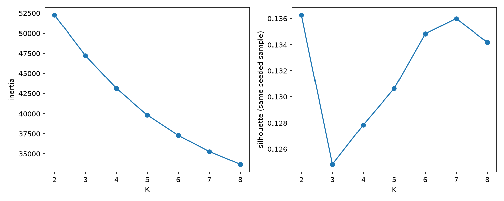
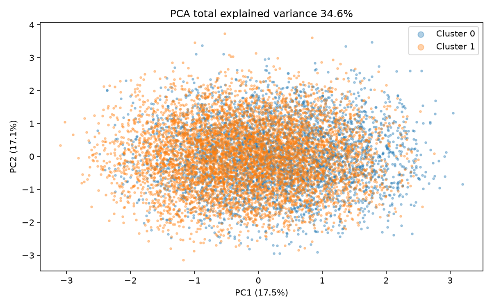
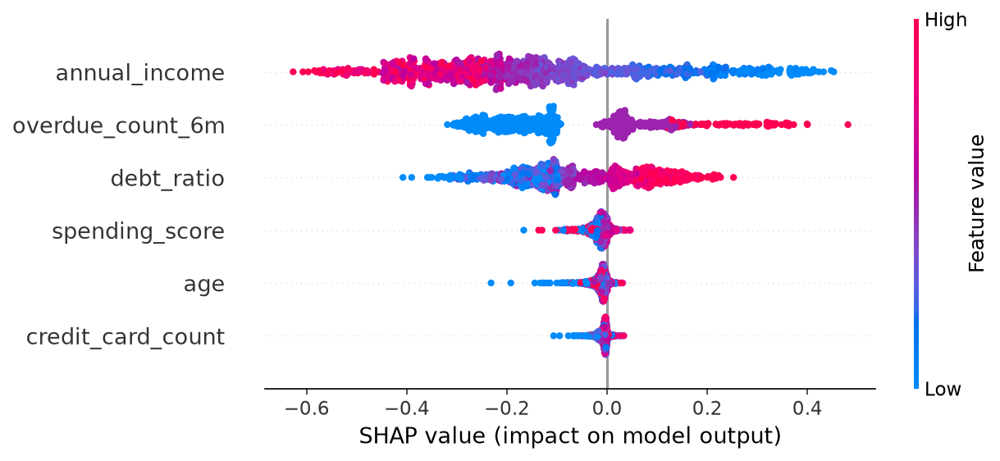
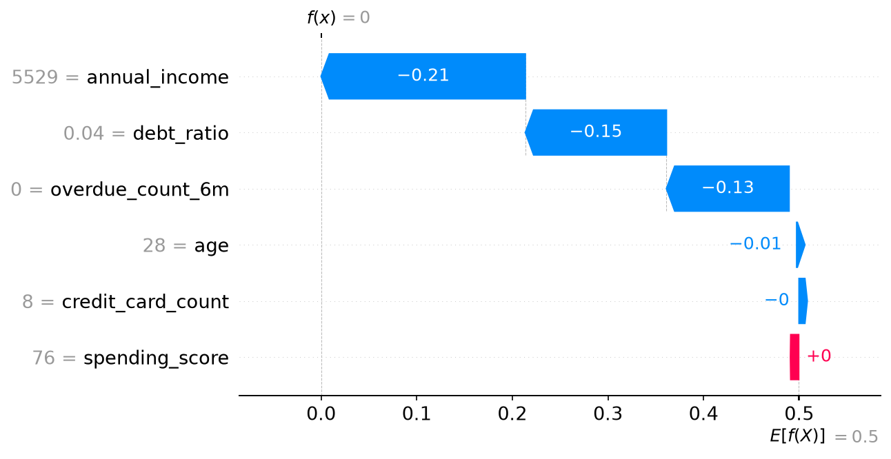
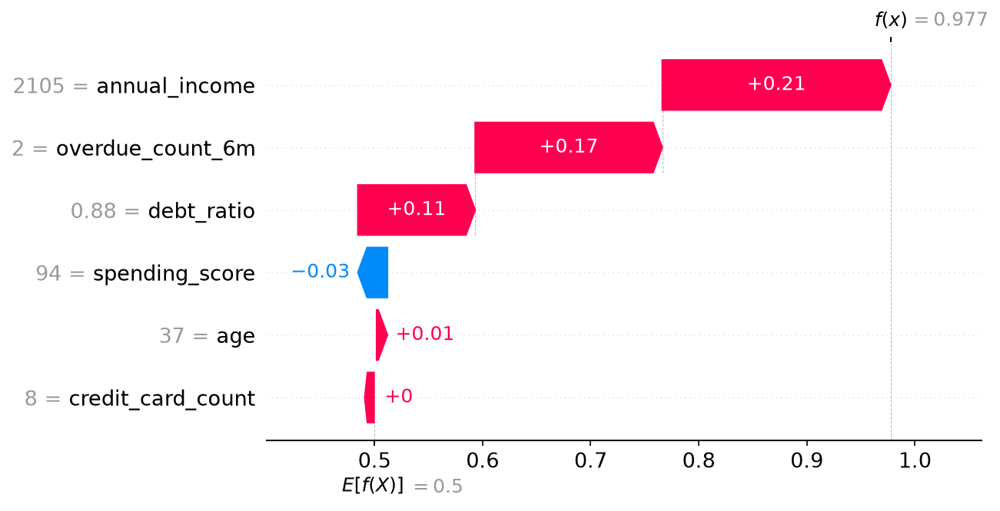
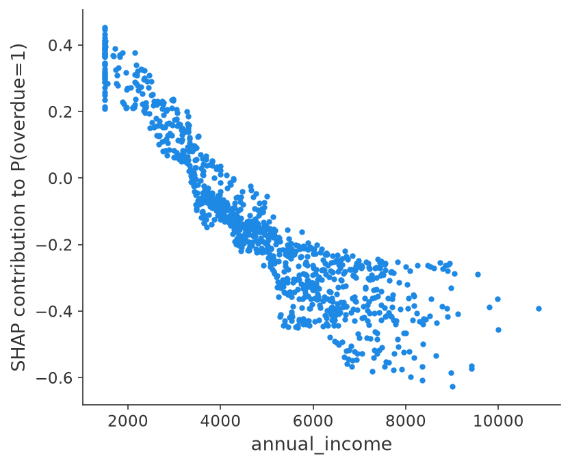
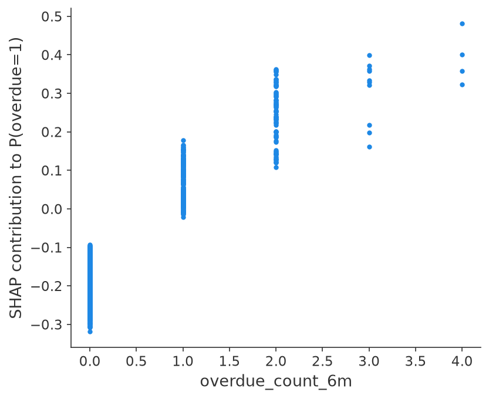
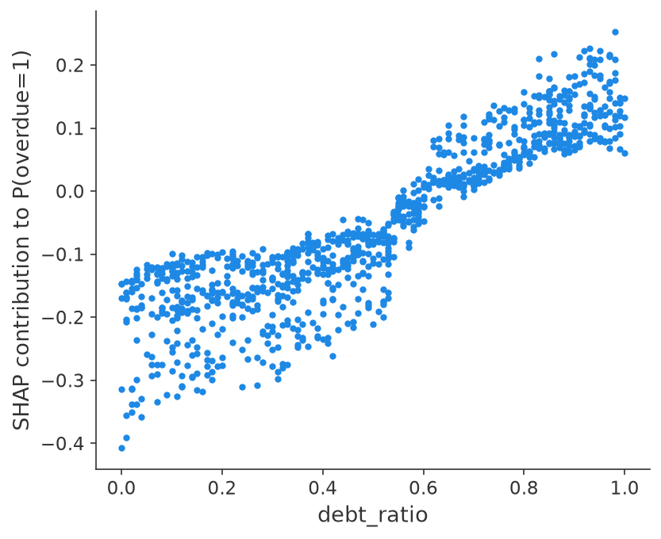
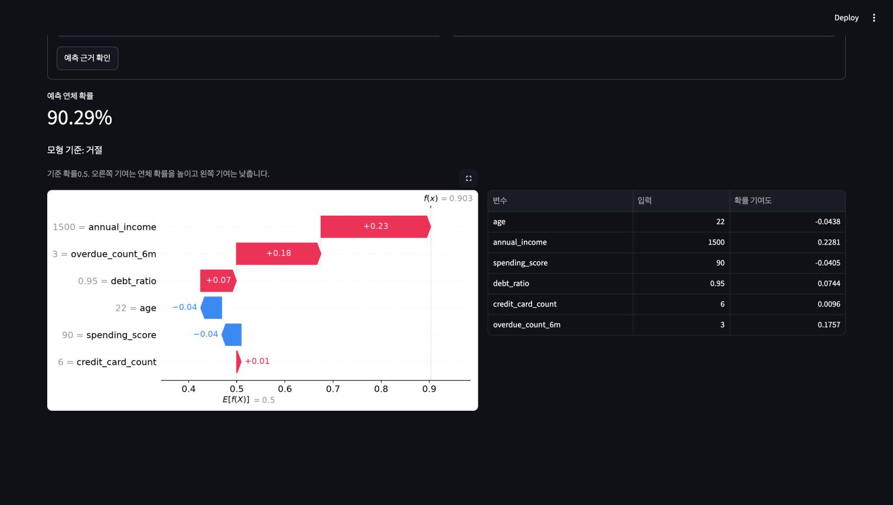

# 금융 고객 군집과 예측 설명

A5-1에서 생성한 동일 금융 데이터와 분류 모델을 사용해 고객 군집, PCA와 SHAP을 분석합니다. 페르소나별 전략과 개별 승인/거절 예측의 근거를 연결합니다.

## 실행 환경

미션 전용 Python3.12.14 venv에서 실행했습니다. Scikit-learn/SHAP/Streamlit의 실제 버전은 requirements.txt에 고정했습니다.

## 분석 순서

군집과 K 선택, PCA와 페르소나를 분석한 뒤 Global/Local SHAP, Streamlit 입력 화면과 대안 군집을 확인합니다. 원문의 거절 확률5 이상은 가능한 확률 범위를 벗어나므로 해석과 실제 기준을 구분해 기록합니다.

## 동일 데이터와 모델

A5-1의10,000행/6입력과 학습 모델을 그대로 복사하고 SHA-256을 확인했습니다. credit_score/is_overdue는 군집 입력에 사용하지 않았으며 원본 CSV에 컬럼/샘플을 추가하지 않았습니다. 카드 수를 포함한 원본6숫자를 표준화합니다. 생성 데이터는 Git에서 제외합니다.

```text
{"data_sha256": "4ddf83dd154ee23bb2374a2bbc1aa56d537ef7ad5114c2f162078756542fe1a2", "model_sha256": "9ddb3ea4c094f839de600aaaad8167a9fc8117919df85cdd86101c020f3a4b03", "exact_copy": true}
```

## K 선택과 PCA

K2~8의 동일 seed42/동일2,000행 Silhouette 비교를 우선했습니다. 가장 높은 K2=0.136276을 선택했습니다. K7=0.135996도 비슷하며 관성의 Elbow는 뚜렷하지 않습니다. 단순한 두 그룹이 최근 연체 유무와 연결되어 설명하기 쉽다는 점을 보조 근거로 사용했습니다.





PC1은17.47%, PC2는17.13%, 두 축의 합은34.61%입니다. 나머지65.39%의 정보가 투영에서 빠지므로2D 겹침만으로6D 군집이 같다고 판단할 수 없습니다. Silhouette 자체도 낮아 강하게 분리된 자연 집단을 발견했다고 주장하지 않습니다.

## 페르소나와 전략

| 군집 | 수 | 최근 연체 평균 | 연 소득 평균 (만원) | 부채비율 평균 | 관측 연체 비율 |
|---|---:|---:|---:|---:|---:|
| 0 | 3931 | 1.287 | 5054.3 | 0.506 | 22.79% |
| 1 | 6069 | 0.000 | 5020.1 | 0.498 | 5.03% |

군집0은 최근 연체 이력이 있는 상환 점검군입니다. 소득/부채의 군집 평균은 군집1과 비슷하므로 소득이 낮은 집단이라고 이름 붙이지 않았습니다. 상환일 안내/분할 상환 상담을 제안하고 추가 한도 제안보다 최근 연체의 회복 여부를 확인하는 전략을 세웠습니다. 군집 전체를 자동 거절하는 규칙으로 사용하지 않습니다.

군집1은 최근6개월 연체0회의 이력 유지군입니다. 정기 납부 혜택과 재방문 안내를 제안하되 저소득/고부채인 개별 고객은 별도 예측 근거를 확인합니다. 관측 연체 비율5.03%이므로 무위험 그룹을 뜻하지 않습니다.

관측 연체 타겟은 군집 fit 이후 해석용으로만 집계했습니다. 이 비율과 전체 데이터의 모델 평균 확률은 미래 검증 성능이 아니며 군집별 전략 효과도 아직 실험하지 않았습니다.

## Global SHAP

동일 RF의 전처리 결과를 TreeExplainer의 tree_path_dependent 방식으로 설명했습니다. seed42로 Test에서1,000명을 비복원 추출했습니다. 변환 내부는 표준화 좌표이고 그림의 Feature 값은 원본6변수 단위로 표시합니다. 양의 SHAP은 is_overdue=1 예측 확률을 높이는 기여입니다.



| 변수 | 평균 절대 SHAP | 낮은 사분위 값의 평균 기여 | 높은 사분위 값의 평균 기여 |
|---|---:|---:|---:|
| annual_income | 0.238140 | 0.172463 | -0.377802 |
| overdue_count_6m | 0.152934 | -0.185803 | 0.102826 |
| debt_ratio | 0.120318 | -0.182332 | 0.111840 |
| spending_score | 0.017596 | -0.024503 | -0.022033 |
| age | 0.016063 | -0.026925 | -0.015682 |
| credit_card_count | 0.009490 | -0.012018 | -0.006656 |

소득이 높을수록 연체 예측 기여가 낮아지는 방향이 뚜렷합니다. 최근 연체 횟수와 부채비율이 높으면 예측 기여가 커졌습니다. 소비/나이/카드 수는 상대적으로 작았고 생성식에 없는 변수의 작은 기여를 인과관계로 해석하지 않습니다.

1,000명 전체에서 base+기여도 합이 predict_proba의 연체 확률과 일치하는지 확인했습니다. 최대 절대 오차는9.04e-15였습니다. 기준값0.499548은 balanced RF의 경로 가중 분포에서 나온 기대 출력으로, 원본의 실제 연체율12.01%와 다릅니다.

## 개별 승인/거절 근거

원문은 거절 확률을5 이상이라고 표현합니다. 확률의 범위0~1과 충돌하므로 실행 기준은0.5로 해석했고 원문과 구분했습니다. 고정 Test에서 가장 낮은/높은 예측 확률 사례를 각각 선택했습니다. 행 번호는 제공 데이터의 위치입니다.



행8156은 소득5529만원, 부채비율0.04, 연체0회로 예측 확률0이었습니다. 소득-0.213607, 부채비율-0.147573, 연체-0.128304가 기준값을 낮췄습니다. 이는 RF의 출력이며 앞으로 연체가 절대 없다는 의미는 아닙니다.



행9205는 소득2105만원, 부채비율0.88, 연체2회로 예측 확률0.977437이었습니다. 소득+0.211206, 연체+0.173064, 부채비율+0.108523이 주요 증가 요인입니다. 실제 is_overdue도1이었으나 한 사례의 일치가 일반 성능을 대신하지 않습니다.

군집 중심과 가장 가까운 사례도 별도로 설명했습니다. 군집0의 행6225는 연체1회라도 소득5396만원/부채비율0.46이 기여를 낮춰0.004132였고, 군집1의 행2707은 연체0회/소득4645만원으로0.002256이었습니다. 군집0 전체 평균 위험과 다른 사례가 있어 군집 이름만으로 개별 심사를 대체할 수 없음을 확인했습니다. [군집0 중심 사례](outputs/waterfall-cluster-0.png), [군집1 중심 사례](outputs/waterfall-cluster-1.png)는 전체 데이터에서 거리로 골랐으며 Test성능 측정용 사례는 아닙니다.

## Dependence와 제언



소득 증가에 따라 기여가 감소하지만 같은 소득에서도 다른 변수의 영향으로 분산됩니다. 소득 정보 확인과 최근 연체/부채의 개별 기여를 함께 보며, 한 소득 구간을 절대 승인 기준으로 사용하지 않습니다.



0회는 음의 기여,2회 이상은 대체로 큰 양의 기여를 보였습니다. 상환 점검군에는 최근 연체 회복의 확인과 상환 일정 안내를 연결하고, 노출 대상/내용/실행 후 연체율의 비교로 전략을 검증하는 계획을 세웠습니다.



부채비율0.5 부근 이후 양의 기여가 많아졌습니다. 이미 연체가 없어도 고부채 고객은 개별 기여를 확인하고 한도 제안의 범위를 조정하는 실험 대상으로 볼 수 있습니다. 이 그래프는 모델의 관측된 연관이며 부채를 낮췄을 때의 인과 효과를 측정한 것이 아닙니다.

## DBSCAN 비교

동일하게 표준화한6변수에 min_samples15, eps0.5/0.8/1.1을 적용했습니다.

| eps | 군집 수 | 노이즈 비율 | 노이즈 제외 Silhouette |
|---|---:|---:|---:|
| 0.5 | 0 | 100.00% | 정의되지 않음 |
| 0.8 | 13 | 35.63% | -0.203906 |
| 1.1 | 3 | 6.17% | 0.086077 |

eps0.5에서는 모두 노이즈였고0.8은13개로 잘게 나뉘며 음의 Silhouette가 나왔습니다. 1.1은3군집/노이즈6.17%/Silhouette0.0861이었습니다. K-Means2의0.1363과 비교하되 DBSCAN은 노이즈를 제외한 표본이므로 지표의 모집단이 다름을 구분합니다. 연속적이고 대부분 독립으로 생성한 입력에 뚜렷한 밀도 경계가 있다고 강제하지 않았습니다.

## 고객 입력 화면

```bash
streamlit run app.py --server.headless true --browser.gatherUsageStats false
```

나이/연 소득/소비 점수/부채비율/카드 수/최근 연체를 입력하면 동일한 RF의 연체 확률과0.5 기준 판단, Waterfall과 변수별 기여 표를 표시합니다. 원문의 대시보드 설명 중 이탈 확률 표현은 실제 타겟에 맞춰 연체 확률로 구분했습니다.

```text
$ python -m unittest discover -s tests -v
----------------------------------------------------------------------
Ran 2 tests in 0.600s

OK
```

[AppTest](https://docs.streamlit.io/develop/api-reference/app-testing/st.testing.v1.apptest)로6개 입력에 실제 승인/거절 사례를 넣고 화면의 확률/판단/6행 기여 표가 모델 출력과 일치하는지 확인했습니다. 동일 데이터/모델 해시와 SHAP 가산성도 확인했습니다.

Chrome에서도6개 입력을 제출해 기본 사례의0.01%/모형 승인, 높은 위험의 가상 사례의90.29%/모형 거절을 직접 확인했습니다. 두 사례의 확률과6행 기여는 같은 모델의 직접 계산과 일치했습니다. Waterfall이 전체 폭으로 지나치게 커지던 배치를 고쳐 기여 표와 나란히 볼 수 있게 했습니다.



## 설치와 재현

Python3.12.14, Scikit-learn1.9.1, SHAP0.54.1, Streamlit1.66.1입니다.

```bash
python3.12 -m venv .venv
source .venv/bin/activate
python -m pip install -r requirements.txt
python prepare.py --source /path/to/A5-1 --data /path/to/finance_data.csv
python analysis_clustering.py
python analysis_shap.py
python -m unittest discover -s tests -v
streamlit run app.py --server.headless true --browser.gatherUsageStats false
```

source에는 A5-1 제출 저장소 경로를 지정합니다. prepare는 데이터/모델 해시를 확인하고6입력 검증 모듈/분류 모델/같은 Train-Test행 위치를 연결합니다. 이후 분석에서도 해시를 재확인합니다. 예측 모델을 새로 학습하거나 원본 CSV를 고치지 않습니다.

[TreeExplainer](https://shap.readthedocs.io/en/latest/generated/shap.TreeExplainer.html)의 경로 기반 기대값/출력 의미를 참고했습니다. SHAP은 이 분류기의 판단을 설명하며 실제 개인의 인과적 연체 원인이나 제안 전략의 효과를 증명하지 않습니다.
